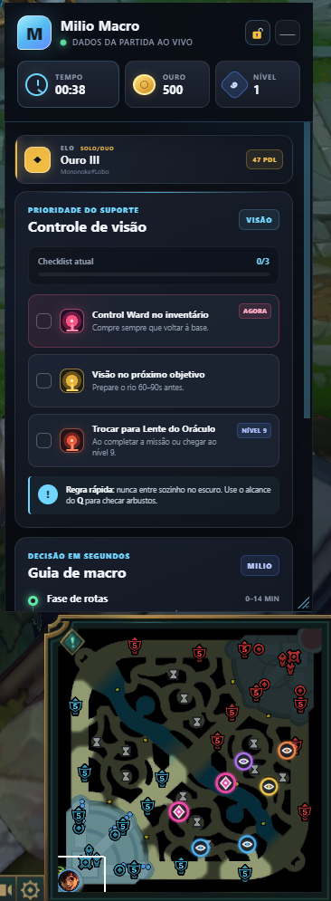
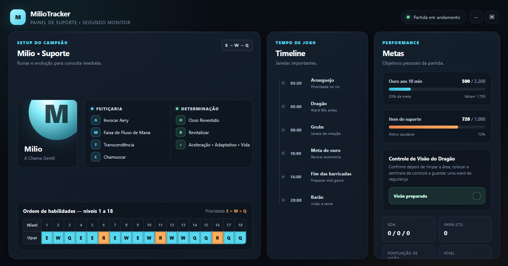
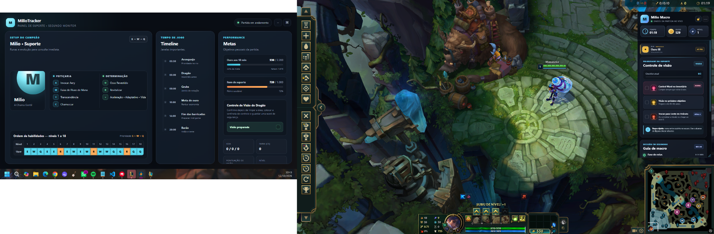

# 🎮 MilioTracker

Desktop companion and in-game overlay for **League of Legends**, focused on players using **Milio Support**.

Built with **Electron, Node.js and JavaScript**, MilioTracker reads live match information and presents useful macro, vision and performance data without interrupting gameplay.

---

## ✨ Features

### 🎯 In-game Support Overlay

A compact overlay designed to stay visible during the match.

- Live game timer
- Current gold
- Champion level
- Ranked information
- Vision control checklist
- Control Ward reminder
- Oracle Lens reminder
- Objective preparation
- Support macro guidance

### 🖥️ Second Monitor Dashboard

A larger dashboard designed for players using a second monitor.

Includes:

- Milio rune setup
- Skill order from level 1 to 18
- Objective timeline
- Scuttle Crab timing
- Dragon timing
- Void Grubs timing
- Baron timing
- Gold goals
- Support item progression
- Vision preparation checklist
- KDA and CS information

### 📡 Live Match Integration

The application reads information from the League of Legends client during an active match and updates the interface dynamically.

---

## 📸 Screenshots

### In-game Overlay



### Second Monitor Dashboard



### Full Setup



---

## 🛠️ Technologies

- JavaScript
- Electron
- Node.js
- HTML5
- CSS3
- League of Legends Live Client Data API
- Git
- GitHub

---

## 📁 Project Structure

```text
MilioTracker/
├── assets/
├── build/
├── src/
├── test/
├── dashboard.html
├── dashboard.js
├── dashboard-preload.js
├── index.html
├── main.js
├── preload.js
├── renderer.js
├── riot-pre-game-controller.js
├── ward-overlay.html
├── ward-overlay.js
├── ward-preload.js
├── style.css
├── package.json
└── package-lock.json
